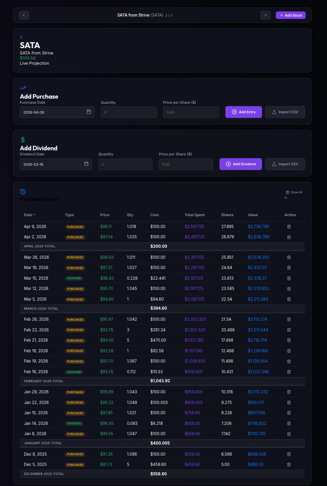
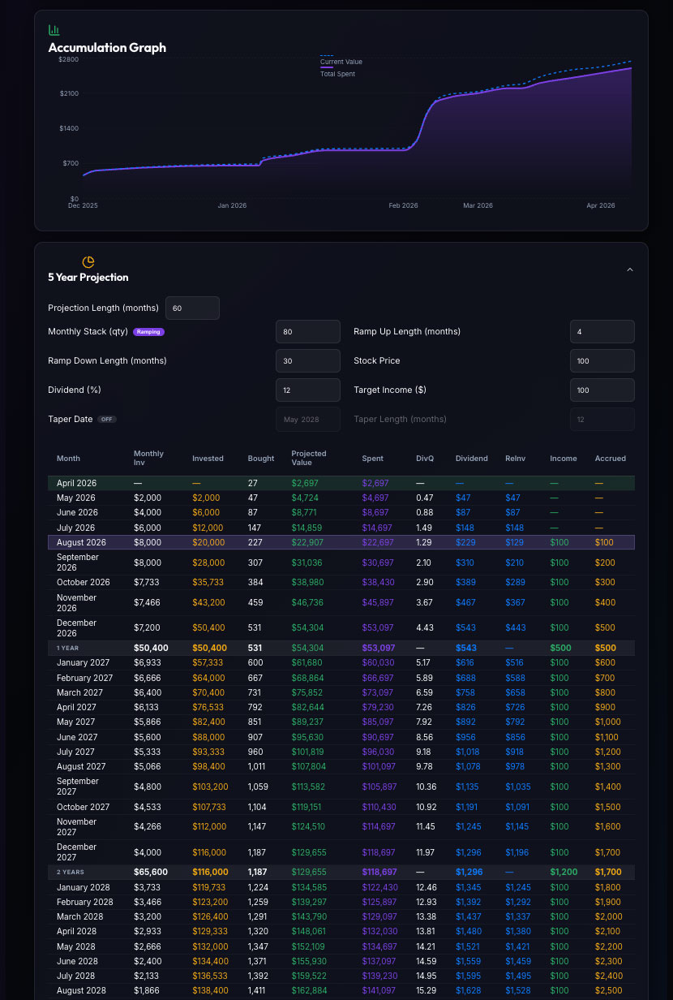
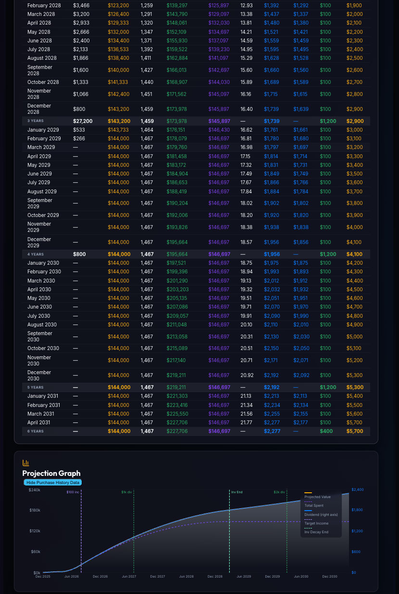

# Moon-Math Dashboard

A stock tracking dashboard for monitoring purchases, dividends, and projecting future portfolio value.

## Features

### Purchase Tracking

Log equity purchases with date, price per share, and quantity. All purchases are displayed in a transaction history grouped by month, giving a clear view of your accumulation over time.

### Dividend Reinvestment Tracking

Record dividend payments and reinvestments alongside purchases. Dividends appear in the same transaction history so you can see the full picture of how your position grows — both through direct purchases and reinvested income.

### Portfolio Value Graphing

An accumulation graph plots your current portfolio value against total capital spent over time, making it easy to see how the position has appreciated and how much of the growth comes from price appreciation vs. your invested capital.

### Future Purchase Projections

Model how your portfolio will grow over time with a configurable projection engine. Set variables like a regular monthly purchase amount, an assumed share price or growth rate, and a dividend yield — the dashboard calculates projected share accumulation and total value across a multi-year horizon and displays it as both a table and a graph.

### Adjustable Projection Variables

All projection inputs are editable directly in the UI. Tweak monthly investment amount, expected price, or dividend reinvestment rate and the projection updates instantly, letting you explore different accumulation scenarios without leaving the page.

## Screenshots


_Transaction history with purchases and dividends, grouped by month_


_Accumulation graph showing current value vs total spent, plus 5-year projection table_


_Extended projection view with full multi-year breakdown and projection graph_

## Running the App

This app has two parts — a React frontend and an Express backend. You need to run both.

First, install dependencies:

```bash
npm install
```

Then, in two separate terminals:

**Terminal 1 — Backend server:**

```bash
npm run server:dev
```

**Terminal 2 — Frontend:**

```bash
npm run dev
```

Then open http://localhost:5173 in your browser.

## Other Scripts

| Command              | Description                               |
| -------------------- | ----------------------------------------- |
| `npm run dev`        | Start the Vite frontend dev server        |
| `npm run server:dev` | Start the Express backend with hot reload |
| `npm run build`      | Build the frontend for production         |
| `npm run preview`    | Preview the production build              |
| `npm run typecheck`  | Run TypeScript type checking              |
